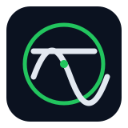

<div align="center">


<p>Shape a motion idea, preview it, and copy the CSS.</p>
<p>   </p>

</div>

## ✨ Overview
A browser playground for a single CSS keyframe animation. Adjust distance, rotation, scale, duration, and easing while a live preview updates. Generated CSS is ready to copy.

## 🚀 Features
- ✨ Live preview with adjustable motion controls
- ✨ Choose common easing curves and animation duration
- ✨ Generate readable @keyframes and animation declarations
- ✨ Copy generated CSS with one click
- ✨ No account, API key, or backend required

## 🎬 Demo
Run the Vite development server and experiment with the sliders. The preview animates in an isolated stage.

## ⚡ Quick Start
```bash
npm install
npm start
# Open the local URL printed by Vite
```

## 🧰 Tech Stack
React, TypeScript, Vite, and plain CSS.

## 🗂️ Folder Structure
```text
.
├── index.html
├── package.json
├── vite.config.ts
├── tsconfig.json
├── src/main.tsx
├── src/App.tsx
├── src/style.css
├── assets/icon.svg
├── .gitignore
└── LICENSE
```

## 🧭 Roadmap
- [ ] Add editable keyframe stops
- [ ] Add reduced-motion preview
- [ ] Export a standalone CSS file

## 🤝 Contributing
Issues and focused pull requests are welcome. Keep changes small and update documentation when behavior changes.

## 📄 License
Released under the [MIT License](LICENSE).

<div align="center"></div>
